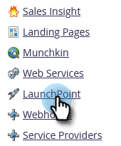
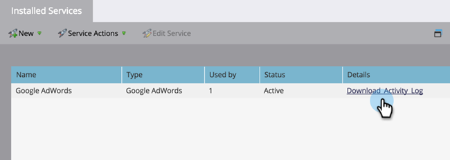

# [!DNL Google Adwords] Aktivitätsprotokoll herunterladen {#download-googleadwords-activity-log}

Erfahren Sie, wie Sie das Aktivitätsprotokoll herunterladen können, um Probleme zu beheben.

1. Klicken Sie in „Mein Marketo&quot; auf **[!UICONTROL Admin]**.

   

1. Klicken Sie **[!UICONTROL LaunchPoint]**.

   

1. Suchen Sie Ihren [!DNL Google AdWords] und klicken Sie auf **[!UICONTROL Aktivitätsprotokoll herunterladen]**.

   

1. Eine .zip-Datei wird auf Ihren Computer heruntergeladen.
