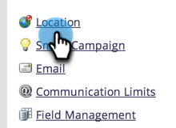
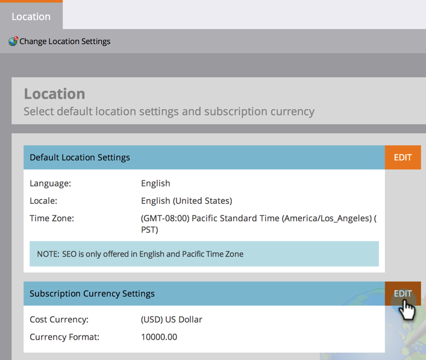
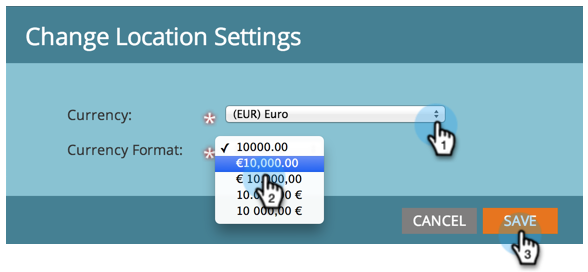

# Standardwährung festlegen {#set-default-currency}

Erfahren Sie, wie Sie die Standardwährung für Ihr Marketo Engage-Abonnement anzeigen und bearbeiten.

>[!NOTE]
>
>**Administratorberechtigungen erforderlich.**

1. Klicken Sie in „Mein Marketo&quot; auf **[!UICONTROL Admin]**.

   

1. Klicken Sie **[!UICONTROL Standort]**.

   

1. Klicken Sie **[!UICONTROL Bearbeiten]** in [!UICONTROL Einstellungen für Abonnementwährung].

   

1. Wählen Sie das gewünschte Währungsformat aus und klicken Sie auf **[!UICONTROL Speichern]**.

   
