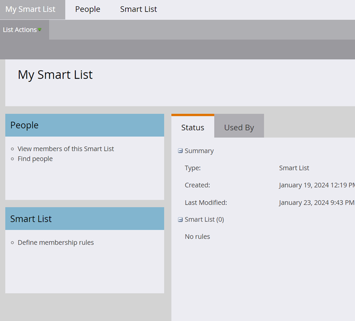
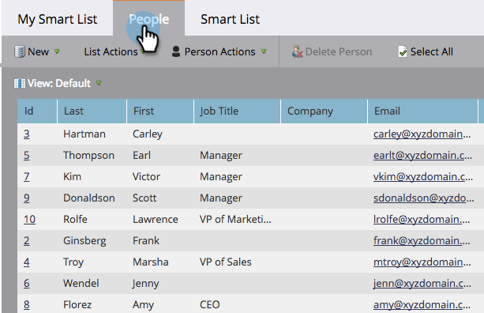
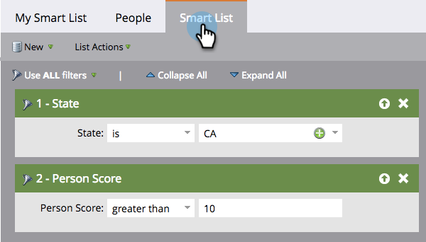

# Grundlegendes zu intelligenten Listen {#understanding-smart-lists}

Mit Smart Lists können Sie mithilfe einfacher Filter bestimmte Personengruppen finden. Sie werden überall in Marketo verwendet, z. B. in intelligenten Kampagnen, Programmen, Berichten, Segmentierungen, Geschäftsmodellen, Interaktionsprogrammen, dynamischen Inhalten und mehr. Je nach Bedarf können Smart Lists an zwei Stellen in Marketo erstellt werden:

1. In der **Datenbank**, wo sie zur gemeinsamen/globalen Verwendung verfügbar sind (z. B. „Alle abgemeldeten Personen„).
1. In **Programmen** als lokale Assets, wo sie eine Gruppe von Personen finden, die für dieses spezifische Programm relevant sind (z. B. „Teilnahme an Fachmesse„).

Die wichtigsten Schritte zum Erstellen einer Smart-Liste sind:

1. [Erstellen einer Smart List&#x200B;](/help/marketo/product-docs/core-marketo-concepts/smart-lists-and-static-lists/creating-a-smart-list/create-a-smart-list.md){target="_blank"}
1. [Suchen und Hinzufügen von Filtern zu einer Smart List](/help/marketo/product-docs/core-marketo-concepts/smart-lists-and-static-lists/creating-a-smart-list/find-and-add-filters-to-a-smart-list.md){target="_blank"}
1. [Definieren von Smart-List-Filtern](/help/marketo/product-docs/core-marketo-concepts/smart-lists-and-static-lists/creating-a-smart-list/define-smart-list-filters.md){target="_blank"}

Im Folgenden finden Sie ein Beispiel dafür, wie eine Smart-Liste aussieht.

## Registerkarte „Haupt“ {#main-tab}

Hier können Sie [den Namen der Smart-Liste bearbeiten](/help/marketo/product-docs/core-marketo-concepts/miscellaneous/rename-a-marketo-asset.md){target="_blank"} und Informationen zur Smart-Liste anzeigen.

## Registerkarte „Personen“ {#people-tab}

Hier sehen Sie die Ergebnisse, d. h. alle Personen, die für die Filter qualifiziert sind, die Sie auf [&#x200B; Registerkarte &#x200B;](/help/marketo/product-docs/core-marketo-concepts/smart-lists-and-static-lists/creating-a-smart-list/find-and-add-filters-to-a-smart-list.md){target="_blank"}Smart-Liste“ hinzugefügt und definiert haben.

## Registerkarte „Smart-Liste“ {#smart-list-tab}

Sie können Filter hinzufügen und definieren, um eine bestimmte Personengruppe auf der Registerkarte [!UICONTROL Personen] anzuzeigen.

>[!MORELIKETHIS]
>
>* [Verwenden von integrierten/System-Smart-Listen](/help/marketo/product-docs/core-marketo-concepts/smart-lists-and-static-lists/using-smart-lists/use-built-in-system-smart-lists.md){target="_blank"}
>* [Erstellen einer Smart-Liste](/help/marketo/product-docs/core-marketo-concepts/smart-lists-and-static-lists/creating-a-smart-list/create-a-smart-list.md){target="_blank"}
